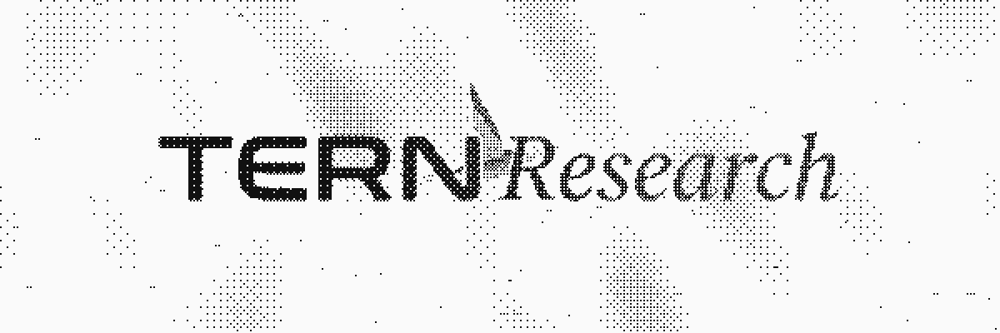

<p align="center">
  <picture>
    <source media="(prefers-color-scheme: dark)" srcset="assets/brand/tern-hero-dark.gif">
    <source media="(prefers-color-scheme: light)" srcset="assets/brand/tern-hero-light.gif">
    
  </picture>
</p>

<p align="center"><b>A local-first agent harness for research and study, with every claim cited and checked.</b></p>

<p align="center">Pre-alpha · private · not yet released</p>

---

Tern turns a rough question into a verified, cited report, and turns what you read into something you can learn from. It runs on your machine, with your own API keys or local models, and shows you what it is doing and what leaves your computer.

It is being built as the research tool for its author's final-year project. It is pre-alpha: the core, provider setup, cited web answers, a terminal chat, the desktop app, Tern Crawl, claim checks with run reports, deep research with parallel workers, and the Study harness (tutor, quizzes, viva, flashcards with spaced repetition and Anki export, Explain in 3D) work today (see below); study plans, the decision model, the library, MCP, evaluation, and the Linux and macOS ports are still ahead.

## What works today

| Area | Working now |
| --- | --- |
| Core | Stable IDs, versioned events, turn state machine, secret redaction, append-only SQLite event log with replay, `tern doctor` |
| Providers | 13 providers (11 remote, Ollama and LM Studio local) on Tern's own adapters; keys tested before they are saved to Windows Credential Manager; streaming replies |
| Turn loop | Bounded by model calls, tool calls, and tokens; loop detection; cancel; policy gate with Allow, Ask, Deny and inline approvals |
| Web answers | `tern ask` and chat search through Tavily, Brave, or SearXNG, read pages behind a network guard, and cite them with a citation check |
| Crawler | **Tern Crawl**, Tern's own crawler and reader, with its own colour logo on every "Read N pages" row: network guard, robots.txt, per-site pacing, a day-long page cache, Readability-style main text, and PDFs read page by page with `[page N]` markers |
| PDFs and pictures | Attach a PDF (up to 32 MB) and its text is read page by page; attach a PNG, JPEG, GIF, or WebP (up to 5 MB) and it goes to the model as a picture (OpenAI-compatible, Anthropic, and Gemini formats), staying in the chat for follow-ups |
| Claim checks | Every cited sentence of an answer is checked against the text Tern Crawl read for its source: Supported, Partly supported, Not supported, or No source, with the quoted passage and a link to it. The chat's model judges; a word-overlap check works offline and fills gaps |
| Deep research | A plan first: the model splits the question into sub-questions (searches, expected source types, budget share) and you run, edit, skip, or cancel it before anything is searched. Workers then research the parts in parallel (3 at once by default), each with its own slice of tokens, pages, and time, reading through Tern Crawl; one answer is written from their notes with one set of citations, then checked and reported like any answer. `tern research --deep "question"` in the terminal; the composer's **Deep research** mode on desktop |
| Run reports | Each answer writes a Markdown and JSON report (question, steps, sources with robots and cache status, claim verdicts, budget and tokens, errors, and a section per worker for deep research); `tern report` prints or exports one |
| Resume | Research runs save a checkpoint at safe points (each tool result; for deep research the approved plan, each worker's reads and notes, each worker's end, and before the answer). A run that crashed, was force-quit, or was stopped picks up where it was, without repeating finished workers or reading their pages again: `tern resume [chat]`, or **Resume** on desktop |
| Steering | Send a note while a run goes: "focus on 2024 sources" guides the rest of the run, "drop sub-question 3", "add: cost comparison", and "redirect 2: …" change a deep run's workers. Notes land at the next safe point and the log says what each did. Type during `tern research`, use `tern steer <chat> "…"` from another terminal, or press Enter in the desktop composer while a run goes |
| Watcher | Put a question on watch (daily, weekly, or any interval). The desktop app re-runs due watches while it is open, and `tern watch run` does from the terminal; each run is diffed against the last report: new sources, changed verdicts, new and dropped claims. There is no operating-system scheduler, so nothing runs while Tern is closed. `tern watch add\|list\|rm\|run` |
| Ledgers | Each run keeps a source ledger (every URL considered, read live or from the cache, or skipped for robots.txt, the budget, a duplicate, or the policy gate) and a budget ledger (tokens, pages, searches, and time per step and per worker), in the run report, `tern ledger`, and the desktop run panel's **Ledger** view |
| Study | Add your materials (PDFs read page by page, notes, folders, vault notes, a research report, links) and Tern splits them into topics with learning objectives and page anchors, and keeps a mastery score per topic (a rating moved by each graded answer, a Leitner box for when it is due, both explained in words). **Tutor**: Explain, Socratic, or Explain like I'm new, citing the pages it teaches from and flagging anything beyond your materials. **Quizzes**: multiple choice, true or false, fill in the blank, and short answer, with an answer key and source page per question; keyed answers are graded exactly, short answers by the model with a word-overlap fallback, in the verdict glyphs; results move mastery and are kept in a history. **Viva practice**: an examiner asks harder questions level by level, follows up on thin answers, and ends with a rubric report (clarity, correctness, depth, use of sources) saved as Markdown. Everything works offline from your materials when no model is set. `tern study add\|list\|rm\|topics\|history`, `tern tutor`, `tern quiz`, `tern viva`; the **Study** harness on desktop |
| Flashcards | Cards written from your materials per topic (basic, cloze `{{c1::…}}`, and "explain why"), each with the page or section it came from; by the model, or offline from definitions, key sentences, and stated reasons. Repeats are skipped; you can edit, suspend, and delete cards. Reviews run on SM-2, the scheduler Anki uses (Again, Hard, Good, Easy; learning steps of 1 and 10 minutes; ease and interval per card), with a daily queue (learning, then reviews due today, then up to 20 new cards), deck statistics, and each answer nudging its topic's mastery. Export a real Anki package (`.apkg`: SQLite collection and media, "Tern Basic" and "Tern Cloze" note types, one deck, tags per topic, the source in its own field, and review cards keeping their schedule), CSV, or Anki-ready TSV, and import CSV or TSV back. `tern cards gen\|review\|list\|stats\|edit\|suspend\|rm\|export\|import`; **Flashcards** on the desktop Study home, with a review screen (the card turns over on the motion curve, keys 1 to 4, Scout holds up a card and reacts) and a deck screen |
| Explain in 3D | A concept from your materials (a topic, a chat answer, or one you name) built as a small isometric machine: blocks, cylinders, plates, and arrows on a floor grid, linked in order, with 3 to 7 steps that light the parts they are about, each captioned and citing its page. Solid shaded faces with a hairline overlay in the monochrome palette and the one accent. On desktop it opens as a tab: hover lifts a part and the machine tilts toward the pointer, click a part to jump to its step, step with the arrows or play them (Space); reduced motion keeps it still. Saved to the study library as JSON with an SVG snapshot, or to the vault as a note. Offline, the scene is built from your materials' key terms. `tern explain3d "concept" --svg FILE`; the cube button on a topic or an answer on desktop |
| Terminal | `tern` / `tern chat`: an 80×24 ratatui chat |
| Desktop app | Windows build on GPUI: chat with streaming answers, chat list (reopen, rename, archive), providers screen, source rows with site icons, context ring, run panel (Summary, Detailed, Raw, Report, Ledger, and Workers for deep research), a plan card for deep research (Approve, Edit, Skip plan, Cancel), steering from the composer while a run goes, a Resume banner for a stopped run, a Watches list in the sidebar with a Watches screen showing what changed, verdict badges on cited claims, attachments (files, folders, nested `.zip`, long paste), `@` references (attachments and sources, `@prompt:` / `@context:`), message actions (copy, reply with a quote, branch into a new chat), session tabs, a responsive layout (panels float over the chat on narrow windows), the locked design (palette C Mono & Lichen, IBM Plex Sans and Mono, Instrument Serif wordmark, Tern glyphs and built-in service logos, an Appearance screen) and Scout, a live mascot rig in the sidebar that reacts to the run, Git for the vault (checkpoints, branches, pull/push, open a pull request on GitHub, baseline files, branch chip in the title bar), a built-in browser (pages as readable Markdown beside the chat, citations and sources open there, Ask about this page), the Editor and vault (Markdown notes, `[[links]]` and backlinks, autosave, Save to vault, agent vault tools), and the motion pass (working line with the moving tern mark and shimmer, sliding panels, the soft light/dark switch), and the Study harness (a Study home with materials and their icons, topics with mastery rings, Tutor, Quiz, Viva, and Flashcards with the due count; a tutor chat with mode chips; a quiz card with instant feedback and a score summary; a viva screen with a timer and the rubric report; a flashcard review and deck screen; Study settings), and Explain in 3D tabs |

Each pull request builds `tern-desktop.exe` and `tern.exe` for Windows x64 as a CI artifact. There are no releases or installers yet.

## Two harnesses, one core

| | Research | Study |
| --- | --- | --- |
| For | Finding out what is true and who said it | Learning it well enough to explain it |
| Produces | Cited reports, literature reviews, evidence tables, fact-check boards, comparisons | Tutoring, flashcard decks, quizzes, viva practice, study plans |
| Method | Plan → search → read → verify → write, with a run report | Explain → check understanding → practise → grade |
| Checked by | Claim verdicts against exact source spans: ■ supported · ✕ contradicted · ○ unverified · ⌀ unreachable · — waived | The same verdict vocabulary, applied to answers |
| Looks like | Cooler surface, square markers, mono labels | Warmer surface, round markers, italic serif labels |

Both share the same projects, library, vault, memory, providers, and permissions. Switch harness per session.

## Planned capabilities

| Area | Planned |
| --- | --- |
| Models | More OpenAI-compatible endpoints and capability probing (13 providers, local Ollama and LM Studio, and keychain storage are built) |
| Decision model | A fast scorer beside the main model that decides fixed choices (which source first, which tool next, does a claim pass) while hard checks keep the final word |
| Control | Safe pause at budget limits, drift detection, and a scheduler that runs watches while Tern is closed (loop detection, steering, run checkpoints, and the in-app watcher are built) |
| Memory | Stable IDs for every query, file, and source; a goal and decision ledger that survives compaction |
| Surfaces | MCP client and ACP server (the terminal UI and desktop app are built) |
| Workspace | The Study playground built on Explain in 3D (Explain in 3D and the built-in browser are built) |
| Vault | Agent edits shown as diffs (plain Markdown notes, `[[links]]`, backlinks, and Git for the vault are built) |
| Study | Study plans, and FSRS scheduling once a deck has enough reviews to fit it (flashcards with SM-2 and Anki export, and Explain in 3D, are built) |
| Library | Chat ranges, sub-sessions, handoffs, a library, bulk delete, highlights and side chats |
| Evaluation | Benchmarks for citation accuracy, cost, and reliability |
| Platforms | Linux and macOS builds |

Full detail: [docs/01-product-spec.md](docs/01-product-spec.md).

## Principles

| # | Principle |
| --- | --- |
| 1 | **Evidence before claims.** A claim stays unverified until a source or check confirms it. |
| 2 | **Local-first.** Your vault, library, and logs live on your machine. |
| 3 | **Your keys, your models.** Remote or local, your choice; no silent provider switching. |
| 4 | **Show what leaves the machine.** Before data goes to a provider, Tern says what and to whom. |
| 5 | **The process folds away, the result stays open.** One quiet line per turn; the full log one click away. |
| 6 | **Calm by default.** Black and white, one restrained accent, motion only on real events. |
| 7 | **The user steers.** Plans first; pause, redirect, and resume at any point. |
| 8 | **One core, many surfaces.** The core owns state and security; UIs only render its events. |

## Architecture

A single Rust workspace. The headless core owns execution and security; the TUI and desktop app subscribe to its events.

| Crate | Role |
| --- | --- |
| `tern-core` | Shared types, stable IDs, versioned events, turn state machine, secret redaction |
| `tern-agent` | Turn engine, planner, tool registry, policy gate, workers, watcher, steering, checkpoints, budgets |
| `tern-providers` | BYOK remote providers and local models, capability probing, usage accounting |
| `tern-decision` | Decision-model slot with a local reranker fallback |
| `tern-crawl` | Fetch, extract, and chunk web pages and PDFs, behind an SSRF and DNS-rebinding guard |
| `tern-store` | SQLite, full-text and vector indexes, append-only event log, artifacts, Anki package export, the Markdown vault |
| `tern-research` | Research pipeline, scholarly sources, claim verification, citations, run reports |
| `tern-study` | Materials and anchors, topics, mastery, tutor, quizzes and grading, viva practice, flashcards and SM-2 scheduling, CSV and TSV, Explain in 3D scenes and their projection; study plans next |
| `tern-tui` | The `tern` CLI and ratatui terminal UI |
| `tern-desktop` | The GPUI desktop app |
| `tern-platform` | Keychain, paths, and OS integration behind traits |

Details and dependency rules: [docs/03-architecture.md](docs/03-architecture.md). Founding decision: [ADR 0001](docs/decisions/0001-rust-gpui-windows-first.md).

## Platform order

| Order | Platform |
| --- | --- |
| 1 | Windows |
| 2 | Linux |
| 3 | macOS |

Every OS difference sits behind `tern-platform`, so ports stay small.

## Roadmap

| Phase | Focus | Status |
| --- | --- | --- |
| 0 | Repository baseline | Done |
| 1 | Design lock: palette, fonts, concept screens, SVG mark | Done |
| 2 | Core skeleton, keychain, store, `tern doctor` | Done |
| 3 | Providers and the first cited answer in the TUI | Done |
| 4 | Crawler and claim verification | Mostly done |
| 5 | Deep research: plans, workers, checkpoints, steering | Mostly done |
| 6 | Desktop app | In progress |
| 7 | Study harness | Mostly done |
| 8 | Decision model | Planned |
| 9 | Continuity and library | Planned |
| 10 | Extensibility: MCP, ACP, skills | Planned |
| 11 | Evaluation | Planned |
| 12 | Linux and macOS | Planned |

Phase detail and exit checks: [docs/04-roadmap.md](docs/04-roadmap.md).

## Getting Tern

Not yet released. There are no installers or packages; test builds come from CI (the `tern-windows-x64` artifact on each pull request).

## Repository layout

```text
.
├── .github/              issue forms, PR template, code owners
├── assets/
│   └── brand/            mark (PNG and SVG), lockups, app icon, animated dither hero
├── crates/               the Rust workspace (11 crates, see Planned architecture)
├── docs/
│   ├── 00-vision.md
│   ├── 01-product-spec.md
│   ├── 02-ui-definition.md
│   ├── 03-architecture.md
│   ├── 04-roadmap.md
│   ├── 05-security-model.md
│   └── decisions/        architecture decision records
├── AGENTS.md             rules for AI coding agents
├── CHANGELOG.md
├── CODE_OF_CONDUCT.md
├── CONTRIBUTING.md
├── LICENSE
├── README.md
└── SECURITY.md
```

## Building from source

| Command | Does |
| --- | --- |
| `cargo build` | Builds the workspace |
| `cargo test --workspace` | Runs the tests |
| `cargo run -p tern-desktop` | Opens the desktop app |
| `cargo run -p tern-tui -- doctor` | Checks paths, keychain, and store |
| `cargo run -p tern-tui -- provider add groq` | Adds a provider key (hidden prompt, tested before saving) |
| `cargo run -p tern-tui -- search add tavily` | Adds a web search key |
| `cargo run -p tern-tui -- ask "your question"` | A cited answer from the web |
| `cargo run -p tern-tui -- research --deep "your question"` | Deep research: a plan to approve, then parallel workers |
| `cargo run -p tern-tui -- report` | Prints the last run report (`--json`, `--out FILE`, `--list`) |
| `cargo run -p tern-tui -- resume <chat>` | Resumes a stopped research run |
| `cargo run -p tern-tui -- watch add "question" --every weekly` | Puts a question on watch (`watch list\|rm\|run`) |
| `cargo run -p tern-tui -- study add notes.pdf` | Adds study materials (`study topics`, `tutor`, `quiz`, `viva`) |
| `cargo run -p tern-tui -- cards gen` | Writes flashcards from your materials (`cards review`, `list`, `stats`, `edit`, `suspend`, `rm`) |
| `cargo run -p tern-tui -- cards export --apkg deck.apkg` | Exports the deck for Anki (`--csv FILE`, `--tsv FILE`; `cards import FILE` reads CSV or TSV) |
| `cargo run -p tern-tui -- explain3d "concept" --svg out.svg` | Builds an Explain in 3D scene and writes a snapshot (`--topic`, `--step N`, `--vault`) |
| `cargo run -p tern-tui` | The terminal chat (`-- chat --provider ollama` for a local model) |

Set `TERN_REDUCED_MOTION=1` (or `"reduced_motion": true` in `preferences.json`) to turn motion off in the desktop app.

## Documentation

| Doc | Covers |
| --- | --- |
| [Vision](docs/00-vision.md) | Why Tern exists and what success looks like |
| [Product spec](docs/01-product-spec.md) | Harnesses, features, chat behaviour, vault |
| [UI definition](docs/02-ui-definition.md) | Layouts, streaming, palette, motion, Scout |
| [Architecture](docs/03-architecture.md) | Crates, contracts, memory, platforms |
| [Changelog](CHANGELOG.md) | Everything merged so far |
| [Roadmap](docs/04-roadmap.md) | Phases and exit checks |
| [Security model](docs/05-security-model.md) | Threats, controls, trust order |
| [Contributing](CONTRIBUTING.md) · [Agent rules](AGENTS.md) · [Security policy](SECURITY.md) | How work happens here |

## Licence

Copyright (c) 2026 Khubaib Nazeer. All rights reserved. Tern is proprietary software; no licence is granted to use, copy, modify, or distribute it. The Tern name, the diving-tern mark, the wordmark, and the Scout mascot are reserved brand assets. See [LICENSE](LICENSE).
